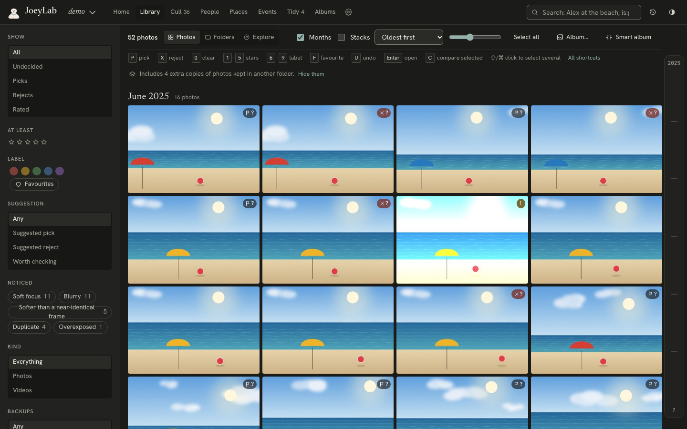
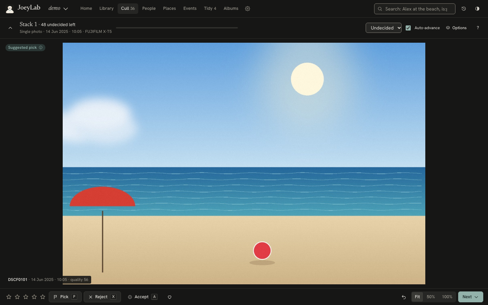
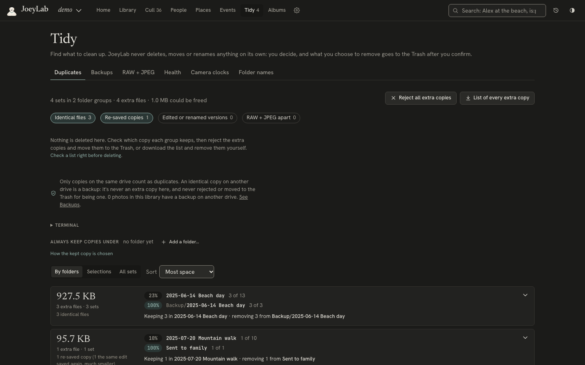
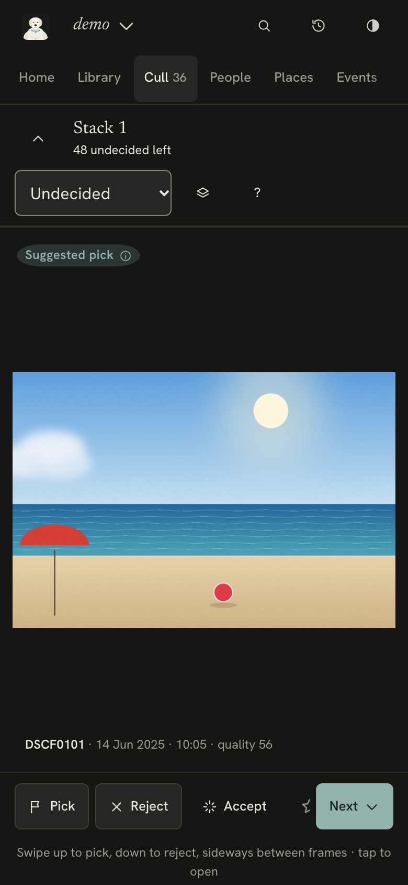

# JoeyLab

*Fetches your photos. Never chews them.*

JoeyLab is a private photo library that runs on your own Mac. Point it at the folders where your photos already
live (on the Mac or on external drives) and it reads them, without changing them: it stacks bursts, suggests the
best frame, finds anything you describe, groups faces for you to name, finds events, trips and places, and shows
duplicates and damaged files. Everything it learns goes into its own catalog in `~/.joeylab`, and nothing leaves
the Mac. You use it in a browser on the Mac, on your phone over Tailscale if you like, from the command line, or
from an AI assistant through MCP. All four work on the same catalog.

JoeyLab is named after Joey, a white Labrador: a retriever that fetches your photos from every drive, sniffs out
the duplicates and brings back the keepers, and never chews anything.

Made by **Yaduraj Bhageria**. Released under the [MIT licence](LICENSE).

* **Cull a shoot:** one burst or scene at a time, the best frame suggested, closed eyes and soft focus flagged,
  one key per decision.
* **Find anything:** type "dog on a beach", "a red umbrella" or "the cake". Search runs on the Mac, with no tagging.
* **People and pets:** faces grouped for you to name once; a child's younger and older groups offered as the same
  person; dogs and cats found and grouped too, so your pet is named once and found everywhere.
* **Events, trips and places:** found from time, place and folder names; place names worked out offline.
* **Tidy:** duplicates on each drive, backups (which photos have an identical copy on another drive, and which exist
  on one drive only), damaged and undated files, camera clocks that disagree.
* **Albums and sharing:** hand-picked and smart albums, best-of sets, share links, galleries.
* **Learns your taste:** after a couple of dozen decisions, its suggestions start to follow yours.
* **Works with other apps:** reads Lightroom Classic catalogs and XMP sidecars, and writes XMP sidecars for
  Lightroom, Capture One and darktable when you ask.
* **Move and rename from the app:** move photos (with their RAW, Live Photo video and sidecars) and folders,
  rename folders, or rename files from a pattern ("2026-01-24 Phuket 001"). JoeyLab keeps track, and every move
  can be moved back. Moves you make in Finder are followed too.
* **Your photos stay as they are:** JoeyLab only reads them, checks after every update that they're unchanged,
  and moves, renames or removes nothing unless you ask.

<p>
  
  
</p>
<p>
  
  
</p>

The screenshots show the demo library (`joeylab demo`), made of generated photos.

## Contents

* [Requirements](#requirements)
* [Install](#install)
* [First run](#first-run)
* [Words JoeyLab uses](#words-joeylab-uses)
* [The app](#the-app)
* [Your photos stay as they are](#your-photos-stay-as-they-are)
* [Privacy](#privacy)
* [Who can open it](#who-can-open-it)
* [On your phone, with Tailscale](#on-your-phone-with-tailscale)
* [Removing what you don't want](#removing-what-you-dont-want)
* [Moving and renaming](#moving-and-renaming)
* [Features in detail](#features-in-detail)
* [AI assistants (MCP)](#ai-assistants-mcp)
* [Command line](#command-line)
* [What it measures](#what-it-measures)
* [Uninstalling](#uninstalling)
* [Contributing](#contributing)
* [Licence and credits](#licence-and-credits)

## Requirements

* **macOS 14 (Sonoma) or later.** Apple Silicon is recommended: the search and face models run on its GPU.
  Linux partly works: the core (scanning, culling, picture search, the web app) runs, but the Mac-only parts
  (Apple Vision labels and text, the background service, Move to Trash) don't, and it isn't tested there.
  Windows isn't supported.
* **Python 3.12 or later**, through [uv](https://docs.astral.sh/uv/), which installs Python for you.
* **exiftool**, for dates, cameras and GPS: `brew install exiftool`. Without it, photos come out undated.
* **Disk space:**
  * about 1.1 GB for JoeyLab and its Python packages with every extra;
  * about 3.4 GB of models, downloaded the first time each feature needs them;
  * room for the catalog in `~/.joeylab`, which keeps a 768 px preview of every photo.

| Model | What it's for | Download |
|---|---|---|
| SigLIP 2 (`ViT-B-16-SigLIP2-384`) | search, naming events by what they show | 1.5 GB |
| CLIP ViT-L/14 | stacking whole scenes, similar photos, taste, how good a photo looks | 1.7 GB |
| LAION aesthetic predictor | the aesthetic part of the quality score | small |
| MediaPipe face landmarker | closed eyes and smiles | 3.7 MB |
| InsightFace buffalo_s (SCRFD + ArcFace) | recognising people, if you turn it on with the most accurate models (personal, non-commercial use only) | about 130 MB, 16 MB kept |
| OpenCV YuNet + SFace | recognising people, if you turn it on with the models free for any use, including paid work | about 39 MB |
| GeoNames town list | place names, offline | about 5 MB |

Apple Vision (labels such as "dog" or "receipt", and text in photos) is part of macOS and needs no download.

## Install

From source, for now:

```sh
brew install uv exiftool
git clone https://github.com/Yadub/joeylab.git
cd joeylab
uv sync --all-extras
uv run joeylab --version
```

`uv run joeylab …` works from that folder. To have `joeylab` everywhere, install it as a tool:

```sh
uv tool install --editable ".[ai,faces,mac]"
```

Once JoeyLab is on PyPI, `uv tool install "joeylab[all]"` will be all it takes (plus exiftool).

The extras are optional. Without them JoeyLab still reads your photos, stacks them by time and look, scores sharpness and
exposure, and finds duplicates:

| Extra | Adds |
|---|---|
| `ai` | search by description, scene grouping, similar photos, aesthetics and taste (PyTorch, open_clip) |
| `faces` | closed eyes and smiles (MediaPipe), and running the most accurate face recognition models (ONNX Runtime); the models free for any use run on OpenCV, which is always there |
| `mac` | Apple Vision labels and text recognition for search |

## First run

```sh
joeylab serve
```

This starts the app at **http://localhost:8765**. Open it in your browser and add a folder of photos. JoeyLab
checks the folder first (it's there, it can be read, it has photos in it) and says why if it can't use it.

The first update reads every photo once. Stacks, duplicates and suggestions come straight after the photos are
analysed, so Cull and Tidy are ready within a minute or two for a few thousand photos; search indexing, faces and
places follow, and each page says what it's still waiting for. The first update also downloads the models it
needs, once (see the table above). After that, updates only look at what changed.

To try JoeyLab before pointing it at your own photos:

```sh
joeylab demo
```

This makes a library of generated photos to explore.

You can also work entirely from Terminal:

```sh
joeylab run ~/Pictures/Wedding -p wedding      # find, analyse, stack, find duplicates, suggest picks
joeylab status -p wedding
joeylab cull -p wedding                         # culling in the terminal, with inline images
```

Each folder or set of folders you add becomes a **library** (`-p` or `--library` names it, as a short name such as
`smith-wedding`; set `JOEYLAB_LIBRARY=wedding` to leave it out). A library is either a **shoot** (cull it down
to a delivery) or an **archive** (browse, name and tidy). Which one it is decides what Home shows.

Rename or remove a library in Settings › This library, or with `joeylab library rename` and
`joeylab library remove`. Both change only JoeyLab's own records, never your photo folders. Removing asks for
the library's name and keeps a backup of its catalog in `~/.joeylab/backups/removed/`.

A folder belongs to one library: JoeyLab won't add a folder that another library already includes.

### Moving folders to another library

When some folders should be treated differently from the rest of a drive (wedding shoots to cull, among everyday
photos to tidy), move them to a library of their own: tick them in **Library › Folders** and press **Move to
another library…** (or use ⋯ on one folder, or Settings › This library), then choose a new library and what it's
for, or one you have. You see the plan first: "Move 52,340 photos (about 48 GB of previews already made, 290,000
faces, 3 people named) from family-archive to a new shoot library “weddings”."

Nothing is read again. Everything JoeyLab knows about those photos goes with them: their files, measurements
and picture vectors, faces and the people they're named as (with their other names), keywords, decisions, RAW
choices and the history of all of them, album places, favourites, comments and backups; their thumbnails and
previews too. Both libraries are then regrouped in the background (stacks, duplicates, events and trips, scores).
It's catalog only: no photo file is read, written or moved. Both catalogs are backed up first
(`~/.joeylab/backups/<library>/before-move-…`), the other library is written and checked before anything leaves the
first, and the first library leaves those folders out from then on (Settings › Folders lists them, with **Include
again**). **Move them back**, in the message that follows or in Settings › This library, undoes it.

If you only want to see those folders together, not treat them differently, a smart album does that without
changing anything: the dialog offers to make one.

```sh
joeylab library split family-archive --folders "/Volumes/Photos/Weddings" --to weddings --purpose shoot
joeylab library moves                  # moves between libraries, with their ids
joeylab library move-back <id>
```

## Words JoeyLab uses

| Word | Means |
|---|---|
| library | a set of folders JoeyLab keeps track of, with everything it knows about their photos |
| catalog | where a library's decisions, names and albums are kept, in `~/.joeylab` (never in your photo folders); "catalog only" means a change to JoeyLab's records, not to your files |
| update | one pass over a library: find new, changed, moved and missing files, analyse new photos, stack them, find duplicates and suggest picks, then faces, search and places. It runs by itself when folders change; **Update now** runs one |
| stack | frames shot together that look alike, shown as one in Cull (and in the Library with **Stacks** on); a photo on its own is a stack of one |
| burst | frames shot a second or so apart; a stack can hold several bursts |
| duplicate set | identical files, or re-saved copies, of one photo on the same drive; one copy is kept and the others are its **extra copies** |
| backup | an identical copy of a file on another drive, in this library or any other. It's never an extra copy, and never moved to the Trash for being one. "Probably" until both files have been read whole in the background; "checked" after |
| folder group | (Tidy › Duplicates) folders whose photos repeat each other |
| face group | faces JoeyLab thinks are one person, waiting for a name |
| pick, reject | your marks on a photo. A reject is only marked: nothing moves until you choose **Move to Trash…** |
| suggestion | JoeyLab's hint (suggested pick, suggested reject, worth checking); nothing is decided for you |

## The app

| Page | What it's for |
|---|---|
| Home | a shoot: progress and next steps. An archive: on this day, trips, recent events, the best of each year, library health |
| Library | filters (status, stars, labels, favourites, keywords, people, places, events, trips, camera, lens, ISO, focal length, dates, edited, videos, backups on another drive), a month-by-month grid with a year scrubber, a folder tree, and **Explore**: every photo on one surface you can zoom and pan, arranged by what's in it (regions named in plain words), colour (a wheel), light (brightness against contrast), time (date against time of day), quality (sharpness against the quality score) or camera; photos glide to their new places when you switch, and the filters choose which show |
| Cull | one stack at a time (a burst, or frames that look alike) on a dark stage; `⇧P` keeps one frame and rejects the rest; `C` compares with the next best; `G` shows everyone's face across the stack so you can pick the frame where nobody blinked; `W` says why a frame was suggested; `S` ticks the shot list; **Stacks** sets how strictly frames are stacked |
| People | name each face group once; suggestions for who else is who, including a child's groups from other ages ("Across the years"); who appears together; a coverage table flags anyone with no picks |
| Places | where photos were taken, worked out offline, on a map drawn on the Mac (or OpenStreetMap's, if you turn it on); each place opens in Google Maps (or Apple Maps) with one click; set your homes from the map or Settings › Places & trips |
| Events | shoots and trips found from time and place across every camera; name them once and the names stay; say where an event was with Set place… |
| Tidy | duplicates on each drive (grouped by the folders they share), backups (per drive and folder: photos with an identical copy on another drive and where, photos on one drive only), damaged files (shown from whatever part is readable), unreadable and undated files, camera clocks that disagree, the untouched check, catalog backups |
| Albums | albums, smart albums that follow a filter, best-of sets balanced across people and moments, a shot list ("first dance", "grandparents") ticked off as you pick, share links |
| Search | `/` or the top bar: describe a photo ("dog on a beach"), use plain language ("Sam in Lisbon in 2023 that I haven't picked"), or fields (`person:Sam place:Lisbon is:pick rating:>3 iso:>800`) |

* `⌘K` opens a command palette that also jumps to any person, keyword, album, named event or trip, folder or year.
* The keys are the same as in the terminal: arrows, 1–5 (stars), P (pick), X (reject), A (accept suggestions),
  U (undo), ⇧U (redo), 6–9 (colour labels), F (favourite), T (keywords), Z (zoom to 100%; ⇧Z 50%), I (info),
  O (histogram, clipping, where it's sharp), ? (all shortcuts).
* `⌘A` in the Library, then **Select all N matching**: stars, picks, rejects, labels, favourites, keywords and
  albums then apply to every photo the filter matches, not just the ones loaded, as one step that one Undo
  takes back.
* The viewer shows why a photo was suggested, every version of it (RAW, JPEG, edits), its event and place, and
  its faces: click an unnamed face to say who it is.
* Undo reverses only what is still as that step left it; anything changed since is kept and reported. Redo puts
  an undone step back. Undo history lives in the catalog, so it survives a reload and works across devices.
* On a phone, swipe up to pick and down to reject. The app installs to the home screen from the browser's share
  menu.
* Every decision is saved at once, to the same catalog the command line uses. New, moved or deleted photos in
  your folders show up about 15 seconds after they land (macOS file events, with a check every 15 minutes as a
  backstop).

## Your photos stay as they are

* **Read-only on your photos.** Everything JoeyLab learns lives in `~/.joeylab/projects/<library>/` (a SQLite
  catalog and thumbnails). It writes next to your photos only when you ask it to: XMP sidecars
  (`export xmp --write-sidecars`, which only adds `.xmp` files, never lowers a rating another app set, and backs up
  any sidecar it updates), moving or renaming the files and folders you choose (see
  [Moving and renaming](#moving-and-renaming)), and moving files you chose to the Trash.
* **Checked, not just promised.** Every update records the size, modification time, change time and inode of every
  file and folder, and after each update JoeyLab compares them again. Tidy shows "Untouched: all N files and
  folders are exactly as before the update", or names what changed (another app, or a copy still in progress).
* **Deleting is up to you.** JoeyLab never removes anything on its own. When you decide to, it moves rejected
  photos, extra copies or empty folders to the Trash, after showing what stays behind for each file and asking
  you to type the count (see [Removing what you don't want](#removing-what-you-dont-want)).
* **Every decision is logged.** Stars, picks, labels, keywords and accepted suggestions go to an append-only
  history; `U` in the app or `joeylab undo` reverses the latest change, and `joeylab history` lists them.
* **Exports never land inside your photos.** Album folders, link folders, lists and spreadsheets refuse any
  destination inside a folder JoeyLab reads, or inside its own data folder, and `--clean` only removes links
  JoeyLab made.
* **Robust to change.** Re-run any time: added, edited, moved or renamed and deleted files are all reconciled.
  A folder renamed in Finder is recognised without reading its photos again (the same files on the same drive,
  or the same names, sizes and times in one new folder); anything else moved is matched by content. Deleted photos are marked *missing*, not forgotten, so your ratings come back if the file does.
  Unplugged drives are skipped, not emptied. Files still being copied are picked up on the next run.
* **Backed up.** The catalog (your decisions, names and albums) is checked and copied every day; see
  [Always on, and backups](#always-on-and-backups).

## Privacy

Everything stays on your Mac: your photos, the catalog, the thumbnails, the faces and the search index. JoeyLab
has no account, no cloud and no telemetry, and it never calls an AI service.

It uses the network only for:

* **Model downloads**, once, the first time a feature needs them (see [Requirements](#requirements)).
* **The GeoNames town list** (about 5 MB, CC BY 4.0), if you want place names. Your locations are looked up in it
  on the Mac; they're never sent anywhere.
* **OpenStreetMap tiles**, only if you turn on the street map in Places. Like any map, the tiles requested show
  OpenStreetMap which area you're looking at. Off, the map is drawn on the Mac from Natural Earth's outlines,
  which come with JoeyLab.
* **Google Maps or Apple Maps**, only when you follow an "Open in Google Maps" link: it's a link, so nothing is
  sent until you click it, and then only that place.
* **Tailscale**, only if you turn it on, to reach JoeyLab from your own devices.

Face data (the numbers that recognise a person) is biometric data about your family and friends. It stays in the
catalog, and Settings › People & privacy removes all of it.

## Who can open it

JoeyLab has one user: you. Only you can open it:

* at the Mac itself, or
* on your own phone and other devices signed in to Tailscale with the Mac's account, or
* (with `--host` and `--token`) through the link carrying the access token.

Anyone else who reaches it sees a notice that it's private, and nothing else. To show someone photos, send them a
share link for an album or an event: it shows that album, read-only, and nothing else of JoeyLab. People you
share with can mark favourites on it, which never change your picks.

Who can reach it:

* `joeylab serve` listens only on this Mac (`localhost`).
* `--tailscale` (off by default) publishes it to your own tailnet with `tailscale serve`: only devices on your
  tailnet can connect, never the open internet. It uses HTTPS when your tailnet has certificates turned on.
* `--host` binds other addresses directly. Any address other than this Mac's own needs `--token`, and the printed
  link carries the token.
* `joeylab share-server` runs a separate server that answers only share links (`/s/…`), never the library or
  its API. Use it to publish share links beyond your tailnet (with Tailscale Funnel or a proxy of your own).

Changes are accepted only from JoeyLab's own pages, so a website you visit can't change your library, and the
server answers only to this Mac's own names.

**A limitation to know about:** other user accounts on the same Mac also count as "at the Mac". If others log in
to your Mac, keep that in mind. The data folder `~/.joeylab` is private to your account.

## On your phone, with Tailscale

[Tailscale](https://tailscale.com) connects your own devices privately. With it on the Mac and on your phone:

```sh
joeylab service install --tailscale
```

JoeyLab then runs in the background, starts at login, restarts itself if it stops, and is reachable from every
device on your tailnet at the address it prints (`https://<your-mac>.<your-tailnet>.ts.net`). Sign in to Tailscale
on the phone with the same account as the Mac and it's you there too. Other people on your tailnet can't open it;
send them share links instead.

`tailscale serve` is used rather than listening on the network directly, because macOS's firewall silently
drops direct connections to the Python that uv installs.

## Removing what you don't want

JoeyLab never deletes anything on its own. When you've decided, it moves files to the macOS Trash for you, after
showing exactly what would go and asking you to type the count.

In the app (owner only):

* filter the Library to **Rejects** and choose **Move to Trash…**;
* in Tidy › RAW + JPEG, **Move N RAWs to the Trash…** for the RAWs you don't need (below);
* or **Move empty folders to Trash…** in Tidy › Library health.

From Terminal:

```sh
joeylab trash-list ~/Downloads/archive-duplicate-extras.txt -p archive   # extras listed by Tidy › Duplicates
joeylab trash-list rejects.txt -p archive --include-last-copies          # e.g. from `export list --rejects`
joeylab empty-folders -p archive                                         # folders left with nothing in them
joeylab empty-folders -p archive --trash                                 # ...and move them to the Trash
joeylab raw-list -p archive                                              # RAWs of RAW + JPEG pairs you rejected
joeylab raw-list -p archive --trash                                      # ...and move them to the Trash
```

Before anything moves, every file is checked, read-only, and you're told what stays behind for each one:

* an identical copy on the same drive (compared byte for byte);
* a re-saved copy of the same photo on the same drive;
* only the photo's other file (its RAW or its JPEG);
* or nothing: it's the last copy on that drive.

The check also says, for each file, whether a backup exists on another drive (only backups compared byte for
byte are named) or that it's the only copy anywhere JoeyLab knows. That is information only: a file never
goes because it has a backup.

Files whose copy stays are moved. Last copies are moved only with `--include-last-copies` (or the matching box in
the app), with a warning. Files that changed since JoeyLab read them, or that aren't part of the library, are
left alone, and each file and the copy that stays are checked again just before the move. Only one move to the
Trash runs at a time.

Finder's Put Back works until you empty the Trash. On an external drive the space comes back when the Trash is
emptied. A log of every run is kept in `~/.joeylab/trash-log`.

### RAWs you don't need

A RAW and the JPEG (or HEIC) the camera saved beside it are one photo. Tidy › RAW + JPEG shows how much space their
RAWs take, and lets you keep only the ones you may edit again. **Reject RAW** marks a photo's RAW to go; the JPEG and
the photo, with all its decisions, always stay. You can reject:
* a whole event's or trip's RAWs at once: **RAWs…** in its ⋯ menu on the Events page, or above it in the Library;
* any photos' RAWs: select them in the Library and press **Reject RAW** (or **Keep RAW**) on the bar;
* one photo's RAW: **R** in the viewer.

Rules keep some RAWs safe unless you reject them yourself: picks, photos with ★3 or more, favourites, photos in an
album, and edited photos (a sidecar with develop settings, or a RAW saved after its JPEG). Each rule can be turned
off. RAWs that no rule keeps are "undecided": they stay unless you reject them (Tidy › RAW + JPEG can reject them all
at once). Undo takes any of this back.

Only the RAWs you rejected ever go to the Trash.

Moving them works like the other moves to the Trash, with these checks for each RAW, at the check and again just
before it moves: the JPEG that stays is there, not empty and reads whole, and the RAW is still rejected. A
RAW with no JPEG beside it is never listed. The RAW's own sidecar (`IMG_1.xmp`, `IMG_1.CR3.xmp`) goes with it; a
JPEG's own sidecar never does. The photo stays in the library, shown from its JPEG, with its stars, picks, albums,
keywords and faces; History's Put Back returns the RAW.

## Moving and renaming

You can reorganise your folders from JoeyLab (owner only), and it keeps track of everything as it goes:

* **Library › Folders:** ⋯ on a folder renames it, makes a new folder inside it, or moves it into another folder.
  A Library filtered to one folder offers the same.
* **Selection bar › Move…:** move the selected photos to a folder (a folder picker with type-ahead and *New
  folder here*), or rename their files from a pattern of date, event, place, folder, current name and a counter,
  with a preview.

Each photo moves whole: its RAW, JPEG, HEIC, Live Photo `.MOV` and the sidecars beside them (`.xmp`, `.aae`),
keeping their names together. You see the plan first ("Move 24 photos (51 files, 1.2 GB) to /Volumes/X9
Pro/2026/Phuket · same drive, instant"), and:

* on the same drive a move is a rename: instant, nothing copied;
* to another drive each file is copied, read back and compared, and only then does the original go to the Trash
  on its drive, so the space comes back when you empty the Trash;
* nothing is ever overwritten: if a name is taken, keep both (" 2" is added) or skip those;
* photos can't be moved out of the library's folders (add the folder to the library first), or onto or off a
  read-only drive.

Your stars, picks, albums, keywords, folder names and keep rules follow, and the next update finds nothing to do.
Every move and rename is logged in `~/.joeylab/move-log` before anything moves; the message after each one has
**Undo**, and **History › Moves and renames** lists them all with **Move back**. If the Mac stops half way
through (a power cut, an unplugged drive), the next move or update finishes it from the log, keeping each photo's
files together.

Moves you make in Finder are fine too: on the next update JoeyLab recognises moved and renamed files and folders
(a renamed library folder as well) and keeps their decisions.

## Features in detail

### Search anything

Type what you're looking for: "dogs", "a red umbrella", "the cake", "a receipt". No tagging is needed. Every photo
is indexed on the Mac in three ways:

* **SigLIP 2** (`ViT-B-16-SigLIP2-384`) on the whole frame plus 9 overlapping zoomed-in tiles, so small objects are
  found, and results show a box where the match is.
* **Apple Vision labels:** 1,300+ objects and scenes, such as dog, door, receipt and cake.
* **Apple Vision text recognition:** words on signs, cakes and documents, in every language Vision reads (English,
  French, German, Italian, Spanish, Portuguese, Chinese, Japanese, Korean, Russian, Ukrainian, Thai, Vietnamese and
  Arabic on macOS 15), telling which one the text is in.

Results are graded *strong* or *possible*; unlikely ones are hidden unless you ask. Indexing reads the local 768 px
thumbnails, not your originals, at about 3 photos a second on an M2 Pro. The search box also takes plain language
("Sam in Lisbon in 2023 that I haven't picked") and fields (`person:Sam place:Lisbon is:pick rating:>3 iso:>800
date:2024-06 #climbing`), all read on the Mac.

### People

Face recognition is **off until you turn it on**: in People, in Settings › People & privacy, on the welcome page,
or with `joeylab faces enable`. When you do, you choose its models; nothing is chosen for you:

| Choice | Models | Good at | Licence | Download |
|---|---|---|---|---|
| **Most accurate** · personal, non-commercial use only | InsightFace buffalo_s: SCRFD finds faces, ArcFace recognises them | telling people apart, and small, turned or poorly lit faces | [non-commercial research use only](https://github.com/deepinsight/insightface/tree/master/python-package#license) | about 130 MB, 16 MB kept |
| **Free for any use**, including paid work | OpenCV's YuNet finds faces, SFace recognises them | clear, front-facing faces; one person is split into more groups and people are mixed up more often | YuNet [MIT](https://github.com/opencv/opencv_zoo/blob/main/models/face_detection_yunet/LICENSE), SFace [Apache-2.0](https://github.com/opencv/opencv_zoo/blob/main/models/face_recognition_sface/LICENSE) | about 39 MB |

If you use JoeyLab for paid work, choose the second, or get a licence from InsightFace. The models are
downloaded once, from fixed addresses, and checked against their known SHA-256 before use. An install that
already had InsightFace's models before there was a choice keeps them.

You can switch later (Settings › People & privacy, or `joeylab faces enable --model …`). The two sets' face
vectors can't be compared, so a switch finds every face again, in each library at its next update. Your
people, their other names, who's you, hidden people and your "not the same person" answers are kept: each face
you named passes its name to the face the new models find in the same place. A face they don't find loses its
name.

Closed eyes and smiles are checked per face with MediaPipe's face landmarker (Apache-2.0), which needs no
enabling, so a blink in a group photo is caught either way.

With recognition on:

* Naming one group finds that person in the rest; "Not them" corrections are remembered.
* Someone can go by several names: Dad is also "Papa" and "Vikram Rao". Search, ⌘K, naming faces and
  assistants find them by any of them; only the main name is written into files. A name belongs to one person,
  and merging two people keeps both their names.
* Two faces in one photo are never put in one group.
* Groups that mix blurred, turned-away or different faces are set aside under **Unclear faces** rather than
  offered for naming.
* In **Name faces**, Enter saves and moves to the next group; Esc then S hides a group as strangers, X as not a
  face.
* A child's face changes year by year, so it ends up in one group per age. **Across the years** offers such a
  group as someone you've named when it's from before or after the years they're named in (up to 4 years apart),
  never in a photo with them, and the faces nearest in time look alike. Yes joins it; No is remembered.

Settings › People & privacy also removes every face, name and face crop at once.

**Pets.** Apple Vision finds the dogs and cats in every photo (on the Mac, with nothing to download or turn on),
and the search model groups them by how alike they look. They wait under **Name faces › Pets to name**: name your
pet's biggest group, and **Is this …?** asks about its other groups. A named pet is listed with the pets, and
searching for its name, the Library's people filter and ⌘K find its photos. **Not ours** hides someone else's pet
or a stray. The search model isn't made to tell animals apart, so two dogs of one breed and colour can share a
group: "Not them" in **Check faces** takes one out.

A dog's face that the face models took for a person's leaves people's groups when Apple Vision sees the dog and
no one there; a face you named is never moved. **Name faces › Animals' faces** lists them, and **A person** puts
one back for good.

### It learns your taste

After about 12 picks and 12 rejects, JoeyLab trains a small model on your decisions, using the picture's AI
embedding plus its quality signals. Once cross-validation shows it predicts your choices reliably, it shapes the
quality score (60% signals, 40% your taste), which changes "best in group", the suggestions and the "Your taste"
sort. It retrains after every 20 more decisions, once you've paused for a moment, and the Overview shows how
accurate it is.

### Stacks and suggestions

Frames shot together are stacked along each camera's timeline. The **Stacks** slider (in Cull, or Settings › This
library) goes from *Bursts only* to *Whole scenes*; while you drag it, it shows what each setting gives ("5,085
stacks, 2,845 with more than one frame") and restacks when you let go. Only the stacks change, never your
photos or decisions.

Suggestions are hints and never become ratings unless you accept them:

* **pick:** the best in its group, or a strong single shot;
* **reject:** blurry, a duplicate copy, closed eyes when a better frame exists, or clearly softer than a
  near-identical twin;
* **worth checking:** something may be off, but not enough to call it a reject (slightly soft, a blink with no
  better frame, exposure trouble). Accepting suggestions never touches a "worth checking".

### Events, trips, places and camera clocks

* Photos from every camera share one timeline. A gap of 3 hours or a jump of 100 km starts a new event, and small
  fragments merge into their neighbours.
* An event is away when its place is further than the trip distance (100 km unless you change it) from every
  home, or in another country than every home. Runs of away events become trips, named after where they went:
  a day or more at home, and even a single day in another country. Set your homes in Settings › Places & trips
  (they're the same for every library); until you do, JoeyLab guesses home as the place seen in the most
  months, and says so.
* Events whose photos have no GPS get a place, marked as a guess, from a folder that names a town, region or
  country ("2023-Cyprus", "Phuket Jan 2026"; not "Nice day out" or "Dad"), or from cameras' clocks set to
  another time zone than home's. **Set place…** on an event or trip replaces any guess and stays.
* Event names come from folder names when those say something ("2024-06 Lisbon trip" gives "Lisbon trip").
  Otherwise they come from what most of the photos show ("Dance performance", "Climbing", "Wedding"), judged on
  the Mac by the search model, and then from the place and date. An Indian wedding's occasions are named too
  (haldi, mehendi, sangeet, baraat, varmala, pheras, vidaai, the reception), and so are sadya, pookalam,
  Diwali and Holi; an event that mixes a wedding's occasions is a "Wedding".
* Your own names stay across updates, and while the drive with the photos is unplugged.
* Places come from GPS in the photos, looked up offline in the GeoNames town list. Photos without GPS borrow the
  place of a photo taken within 3 hours (often a phone shot at the same event).
* When two cameras' clocks disagree (a second body never set to local time, or 12 hours off), Tidy finds it by
  matching photos of the same moment and suggests an offset. Applying it changes only JoeyLab's timeline; the
  files keep their dates.

### Drives

External drives are known by their volume ID, not their name. Rename "Photos SSD" to "Archive" (or plug it in
next to another drive with the same name, so it mounts as "Photos SSD 1") and the catalog follows: paths are
updated, nothing is marked missing, decisions stay. If a *different* drive turns up under the old name, its
folders are held back rather than scanned as yours. Nothing on any drive is changed either way.

### Keywords

Your own tree of keywords ("Activities › Climbing", "Family › Grandparents"), kept in the catalog:

* Press `T` on a selection or in the viewer, type a keyword (› or > for a level) and Enter.
* The Library shows the tree with counts; a keyword finds everything under it, and "No keywords" finds what's
  left to tag. Search with `#Climbing` or `keyword:none`.
* Tagging is in the history, so `U` undoes it. **Manage…** renames, moves, merges or removes keywords.
* Keywords go to XMP the way Lightroom writes them (`dc:subject` with every level, `lr:hierarchicalSubject`
  paths), come in from a Lightroom catalog or from `.xmp` sidecars, and travel in the portable decisions file and
  the CSV.

### Albums, sharing and galleries

* Albums live in the catalog: hand-picked, smart (they follow a filter), or best-of sets balanced across people
  and moments.
* A shot list ("first dance", "grandparents") is ticked off as you pick. For a moment search can't recognise, press
  S on a frame in Cull to say which moments it shows; it covers them once it's picked.
* An album or event can get a **share link** (`/s/<token>`, with an expiry) that shows just that album to people
  who can reach JoeyLab. They can mark favourites, which are kept as their own layer and never change your
  picks. The Library can show "everyone's favourites" or one person's.
* The owner can also make a folder of links or copies, or a self-contained web gallery, anywhere outside the
  folders JoeyLab reads.

### Always on, and backups

```sh
joeylab service install      # run in the background, start at login, restart if it stops
joeylab service status       # also: start, stop, restart, logs
joeylab service uninstall    # stop it and don't start it at login
joeylab backup               # back up every catalog now (the server also does it daily)
joeylab restore -p wedding   # bring back the latest daily backup (the current catalog is kept first)
```

`service install` takes `--tailscale` and `--watch` like `serve`. Logs are in `~/.joeylab/logs`.

Backups are checked (`PRAGMA quick_check`) before they're copied, and kept for 14 days, then one a week for
8 weeks and one a month for a year, in `~/.joeylab/backups`. Daily copies leave out the search index (it's
rebuilt from the thumbnails); a full copy is made at least weekly. Catalog upgrades take their own backup first
and either finish completely or leave the catalog as it was. Only one update runs per library at a time, whether
it comes from the app, the command line or the service.

## AI assistants (MCP)

JoeyLab doesn't call any AI service. If you use an assistant, add JoeyLab to it once as an MCP server and it
can work with your libraries from a conversation ("make an album of the 30 best photos of Sam from 2025", "which
trips have nobody named in them?"). Any MCP client works; for example, Codex or Claude Code:

```sh
codex mcp add joeylab -- joeylab mcp
claude mcp add joeylab -- joeylab mcp
```

Other clients run the same command, `joeylab mcp`. Settings › AI assistants shows the full path to use if
`joeylab` isn't on your PATH.

* The assistant can search, look at 768 px thumbnails (never the originals), list people, events, places and
  keywords, and check library health.
* With changes allowed, it can also set picks, stars and labels, tag photos and make albums. To let it look but
  never change anything, use `joeylab mcp --read-only`.
* Its changes are logged under its own name ("Codex: picks for the album"). `U` in the app reverses the latest
  change, whoever made it; the assistant's own `undo_last` only reverses its own.
* Nothing it does touches your photo files.

## Command line

Run `joeylab --help`, or `joeylab <command> --help`, for every option.

| Command | What it does |
|---|---|
| `serve` | the web app (`--tailscale`, `--token`, `--port`) |
| `service install / uninstall / status / start / stop / restart / logs` | keep the web app running in the background |
| `demo` | make a library of generated photos to try JoeyLab on |
| `run PATH… -p NAME` | add folders and update the library: find new and changed photos, analyse, stack, find duplicates, suggest picks, then faces, search and places |
| `scan`, `analyze`, `organize` | the steps of `run`, one at a time |
| `status`, `library list`, `library rename`, `library remove`, `roots list`, `roots remove` | what's in a library; every library; rename or remove one (JoeyLab's records only); its folders |
| `library split`, `library moves`, `library move-back` | move folders to another library with everything known about their photos; list those moves; move one back |
| `cull` | culling in the terminal |
| `list`, `show`, `search`, `similar` | find photos |
| `rate`, `accept-suggestions`, `tag`, `keywords` | decide and tag without the app |
| `undo`, `redo`, `history` | the decision history |
| `dupes`, `backups`, `health`, `events`, `places` | duplicates, backups on other drives, library health, events and trips, places |
| `faces enable` | turn on face recognition, choosing its models (`--model insightface` or `--model opencv`, or asked); with the other models than before, switch |
| `export album / list / csv / xmp / decisions` | get photos and decisions out |
| `import decisions / lightroom / camera-ratings` | bring decisions in |
| `verify-list`, `trash-list`, `empty-folders`, `raw-list` | check a list of files, move files, empty folders or RAWs you don't need to the Trash |
| `backup`, `restore`, `prune` | catalog backups; forget photos that are gone for good |
| `mcp` | the MCP server for AI assistants |
| `share-server` | a server for share links only |

### Culling in the terminal

```sh
joeylab cull -p wedding
```

| Key | Action |
|---|---|
| ← → ↑ ↓ / h j k l | move between frames |
| 1–5 / 0 | star rating / clear |
| p / x | toggle pick / reject |
| a | accept the page's suggestions (only undecided frames) |
| u | undo (a whole `a` batch at once) |
| space | zoom the selected frame · o opens it in Preview |
| n ⏎ / b | next / previous page · q quit (everything is saved as you go) |

Pages are stacks (the suggested best frame is marked); single shots come 8 at a time.
Useful variants: `cull --undecided` (carry on where you stopped), `cull --groups-only`, `cull --suggested reject`
(review what it thinks is bad), `cull --flag eyes-closed`, `cull --min-quality 70`.

Inline images need iTerm2, WezTerm, Kitty or Ghostty. Inside tmux, run `tmux set -g allow-passthrough on` (or put
it in `~/.tmux.conf`). Without images you get a text list, and `o` opens the photo in Preview.

### Finding things

```sh
joeylab search "bride and groom laughing" -p wedding --album ~/Albums/laughing
joeylab similar 123 -p wedding              # everything that looks like photo 123
joeylab list -p wedding --sort quality -n 30
joeylab list -p wedding --flag blurry
joeylab dupes -p archive                    # exact copies and re-saved copies
joeylab show 123 -p wedding
joeylab events -p archive                   # events (add --trips for trips)
joeylab places -p archive
joeylab health -p archive                   # duplicates, single-copy photos, unreadable, undated
joeylab backups -p archive                  # photos with a copy on another drive, per drive and folder
joeylab backups -p archive --check          # ...reading the probable backups whole now (read-only)
```

### Decisions in and out

```sh
joeylab undo -p wedding                     # reverse the latest change (from the app or Terminal)
joeylab history -p wedding
joeylab export decisions wedding.json       # every decision, album, person, event and folder name
joeylab import decisions wedding.json       # re-attach to a fresh catalog (matched by content, not path)
joeylab import lightroom ~/Pictures/Lightroom/Catalog.lrcat   # stars, picks and labels (read from a copy)
joeylab import camera-ratings               # stars set in camera or by another app (XMP / EXIF Rating)
```

Imports only fill in photos you haven't decided on yet, unless you pass `--overwrite`, and each import is one
undoable step. Renamed exports (`DSCF6148.JPG` → `2025-Lisbon-88.jpg`) are recognised as edits of the original,
never as duplicates.

### Exports

```sh
joeylab export album DEST [filters] [--files preferred|raw|jpeg|all] [--copy] [--clean]
joeylab export list --rejects -o rejects.txt     # a list to review, or to give to trash-list
joeylab export list --flag duplicate -o extras.txt
joeylab export csv photos.csv
joeylab export xmp --write-sidecars [--style stem|full]   # stars and picks for Lightroom, Capture One, darktable
joeylab export xmp --write-sidecars --include rating,label,keywords,people,regions
joeylab verify-list extras.txt -p archive        # check each listed extra still has its kept copy
```

Filters shared by `list`, `cull` and `export`: `--picks --rejects --undecided --min-rating N --suggested
pick|reject|check --flag F --min-quality Q --camera S --in PATH_SUBSTR --from YYYY-MM-DD --to YYYY-MM-DD`.

## What it measures

| Signal | How |
|---|---|
| RAW+JPEG pairing | same folder and file name; one "photo" per pair |
| capture time, camera body | exiftool (with the time zone when the camera records one); grouped per body (by serial number) so two shooters with unsynced clocks don't mix; per-body clock offsets put every camera on one timeline |
| place | GPS from EXIF, looked up offline in GeoNames; borrowed from a GPS photo within 3 hours |
| edits and versions | a renamed or re-exported copy is linked to its original (same capture instant and picture); the editing app comes from EXIF Software; Content Credentials (C2PA) are noted |
| fast previews | JPEG DCT-scaled decoding; RAW files use their embedded JPEG preview |
| sharpness | Laplacian variance: the sharpest tiles (the subject, tolerant of bokeh) and the faces |
| exposure | clipped highlights and shadows, brightness |
| faces, closed eyes, smiles | MediaPipe face landmarker blendshapes (big laughs aren't counted as closed eyes) |
| face quality | Apple Vision's face capture quality (focus, light, expression, how the head is turned), per face; a quarter of the faces part of the score, and in Cull's face compare it only chooses between frames with as many eyes open |
| aesthetics | LAION aesthetic predictor on CLIP ViT-L/14, with Apple Vision's aesthetics score (kept with the search index on a Mac) as a quarter of it |
| stacks | time gap and perceptual hash, plus CLIP similarity when the `ai` extra is installed |
| duplicates | identical bytes on the same drive (hashed only among files of the same size) and re-saved copies (same capture instant, near-identical pixels) |
| backups | the same size and quick fingerprint as a file on another drive, in any library, makes a probable backup; the whole of both files is then read in the background, slowly, to check it |

Quality (0–100) combines sharpness, exposure, faces and aesthetics, and your taste once it's trusted.

## Uninstalling

```sh
joeylab service uninstall      # if you installed the background service
```

Then delete:

* `~/.joeylab`: every catalog, thumbnail, backup, log and model JoeyLab downloaded itself. Your decisions,
  names and albums live only there, so export them first if you might come back
  (`joeylab export decisions ~/Documents/joeylab-wedding.json -p wedding`).
* The two search models in `~/.cache/huggingface/hub` (folders starting `models--timm--`), unless another app
  uses them.
* The JoeyLab folder you cloned, or `uv tool uninstall joeylab` if you installed it as a tool.

Your photos were never changed. Anything you asked JoeyLab to write stays where you put it: XMP sidecars next to
your photos, and album folders, galleries and lists wherever you made them.

## Contributing

Bug reports, ideas and pull requests are welcome. [CONTRIBUTING.md](CONTRIBUTING.md) explains how to set up,
run the tests and the rules every change keeps; [docs/ARCHITECTURE.md](docs/ARCHITECTURE.md) shows how it's built,
and [docs/ROADMAP.md](docs/ROADMAP.md) what's next. To report a security problem, see [SECURITY.md](SECURITY.md).

## Licence and credits

JoeyLab is made by Yaduraj Bhageria and released under the [MIT licence](LICENSE).

It stands on other people's work: the SigLIP 2, CLIP, LAION aesthetic, MediaPipe, InsightFace and OpenCV (YuNet, SFace) models, the
GeoNames town list, Natural Earth, OpenStreetMap, the Hanken Grotesk, JetBrains Mono and Newsreader fonts, Leaflet, exiftool and
many open-source Python libraries. [THIRD_PARTY_NOTICES.md](THIRD_PARTY_NOTICES.md) lists them with their
licences. Note that the InsightFace face recognition models are for non-commercial use only; YuNet and SFace,
the other choice, may be used for anything.
